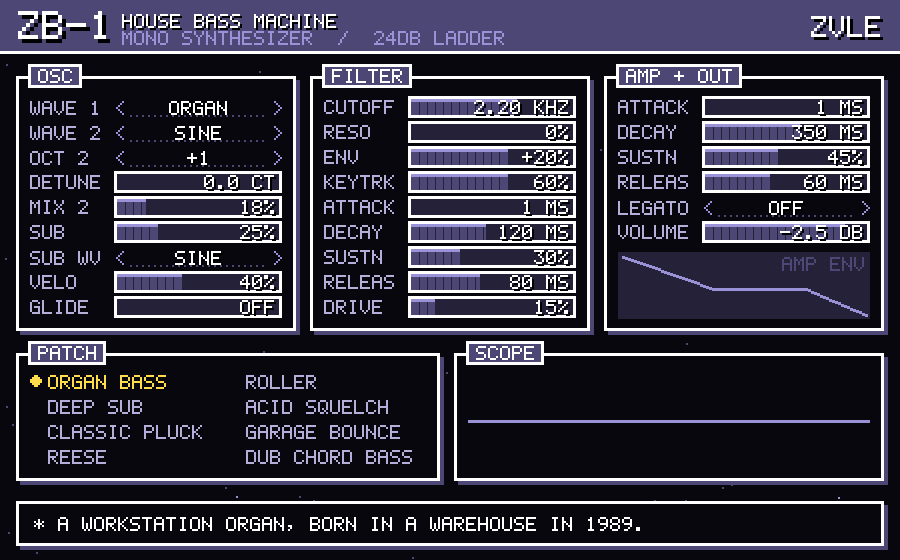

# ZB-1 — House Bass Machine (by ZVLE)

A mono, Korg-workstation-flavoured bass synth as a VST3 instrument, with a
hand-drawn pixel-RPG interface in #4d4775.

## Install on your Mac (one time, ~5 minutes)

1. Unzip this folder somewhere (Desktop is fine).
2. Open **Terminal**, type `bash ` (with a space), drag `INSTALL_ON_MAC.command`
   into the Terminal window, press Return.
   - If Apple's command line tools aren't installed, a popup asks to install
     them. Click Install, then run the command again.
   - It installs Rust if needed, builds the plugin, and copies `ZB-1.vst3`
     into `~/Library/Audio/Plug-Ins/VST3`.
3. In FL Studio: **Options → Manage plugins → Find installed plugins**, then
   add **ZB-1** (vendor ZVLE) from the Generators list.

## Using it

- **Patches**: click any name in the PATCH box to load it. Eight house bass
  starting points: Organ Bass, Deep Sub, Classic Pluck, Reese, Roller,
  Acid Squelch, Garage Bounce, Dub Chord Bass. Your edits save with the project.
- **Bars**: click or drag to set. Hold **Shift** while dragging for fine
  control. **Double-click** to reset to default.
- **< VALUE >** selectors: click the left or right half to step through.
- The bottom box shows the exact value of whatever you hover.

## The engine

- 2 oscillators (Saw / Square / Sine / Organ), osc 2 octave + detune, mix
- Sub oscillator one octave down (sine or square), routed around the filter so
  the low end stays solid at any cutoff
- 24 dB/oct zero-delay ladder low-pass with saturating resonance and bass
  compensation, envelope (bipolar) and key tracking
- Separate filter and amp ADSR, velocity amount
- Mono last-note priority, glide, legato
- Drive, volume, all automatable from FL

`render/` has WAV renders of every patch playing a 124 BPM house line.

## Rebuilding after edits

`cargo xtask bundle zb1 --release` — output lands in `target/bundled/`.
Source: `src/dsp.rs` (sound), `src/presets.rs` (patches), `src/editor.rs` (UI).
